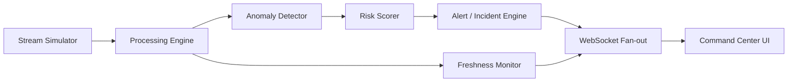

# SENTINEL

Real-Time Decision Intelligence Platform for Microsoft Innovate 2026 — Problem Statement #34: **“Decisions While the Data’s Still Warm.”**

Python/Streamlit sibling demo: **[PulseGuard](pulseguard/README.md)** (`cd pulseguard && python run.py`) — FastAPI + SQLite WAL + live fraud/risk thresholds + optional Fabric Eventstream sink.

## Problem statement

Build a dashboard that automatically updates as new data arrives, shows live KPIs, and alerts when a value crosses a threshold — with incremental/streaming refresh, a visible data-freshness SLA, automated failure detection, and performance validation under concurrent load.

## What SENTINEL solves

SENTINEL answers, in real time:

1. What is happening right now?
2. Is anything abnormal?
3. How serious is it?
4. Which region/service is affected?
5. Has a threshold been breached?
6. How fresh is the data?
7. Is the data pipeline healthy?
8. What should the operator investigate?
9. What is likely to happen next? (advisory forecast)

## Architecture

Monorepo:

| Package | Role |
|---------|------|
| `packages/shared` | Zod-validated contracts (Event, Alert, Incident, Risk, Health, …) |
| `apps/api` | Simulator → processing → anomaly/risk/alerts/freshness → WebSocket + REST |
| `apps/web` | Command Center, Alert Center, Geo map, Perf report |



The simulator is swappable: later replace with Kafka, Azure Event Hubs, Fabric, IoT, or government feeds without rewriting the UI.

## Data flow

1. Simulator emits continuous `StreamEvent`s (not a static CSV reload).
2. Processing engine maintains rolling windows (mean, std-dev, z-score, rates).
3. Layered anomaly detection (threshold → statistical → persistence).
4. Explainable risk score (0–100) with contributor breakdown.
5. Alerts/incidents with mandatory reasons and audit timestamps.
6. Freshness monitor enforces `FRESHNESS_SLA_SECONDS`.
7. WebSocket pushes KPI / chart / alerts / health to the UI.

## Real-time mechanism

- **Transport:** WebSocket at `ws://localhost:4000/ws`
- Heartbeats every 5s, automatic client reconnect with backoff
- Snapshot on connect; incremental updates thereafter
- Demo controls call REST (`POST /api/demo`) which changes the **backend** simulator mode

## Anomaly detection

| Level | Method |
|-------|--------|
| L1 | Configurable threshold (`current > threshold`) |
| L2 | Rolling mean / std-dev / z-score / % deviation |
| L3 | Temporal persistence (avoid one-off spikes) |

Severities: `INFO` · `LOW` · `MEDIUM` · `HIGH` · `CRITICAL`

## Alert system

States: `ACTIVE` → `ACKNOWLEDGED` → `RESOLVED`  
Each alert stores `created_at`, `acknowledged_at`, `resolved_at`, severity, reason, source, affected entity.

## Freshness SLA

Visible in the header and system health panel:

- Last event · event age · ingestion latency · freshness · SLA · pipeline status  
- Pipeline failure mode stops emission → SLA breach → system health alert → recover

## Failure handling

Demo: **Simulate pipeline failure** → stream pauses → freshness ages → SLA breach alert → **Recover pipeline**.

## Load testing

```bash
npm run load-test
```

Or UI **Perf** tab / `POST /api/perf/run` with `{ "target_eps": 5000, "duration_seconds": 3 }`.  
Results are measured from the real processing path.

## Setup

**Requirements:** Node.js 20+

```bash
npm install
npm run build -w @sentinel/shared
npm run dev
```

- API: http://localhost:4000  
- UI: http://localhost:5173  
- Health: http://localhost:4000/health  
- WebSocket: ws://localhost:4000/ws

Copy `apps/api/.env.example` to `apps/api/.env` to override defaults.

## Environment variables

| Variable | Default | Meaning |
|----------|---------|---------|
| `PORT` | `4000` | API port |
| `CORS_ORIGIN` | `http://localhost:5173` | Allowed origin(s), comma-separated |
| `FRESHNESS_SLA_SECONDS` | `5` | Max acceptable event age |
| `HIGH_RISK_THRESHOLD` | `80` | Risk → HIGH |
| `CRITICAL_RISK_THRESHOLD` | `90` | Risk → CRITICAL |
| `NORMAL_EVENTS_PER_MINUTE` | `1150` | Simulator normal rate |
| `ANOMALY_Z_SCORE_THRESHOLD` | `2.5` | L2 sensitivity |
| `ANOMALY_PERSISTENCE_MS` | `8000` | L3 duration gate |
| `THRESHOLD_FAILURE_RATE` | `5` | L1 threshold (%) |
| `PRIMARY_METRIC` | `failure_rate` | Chart / KPI focus |
| `LOG_LEVEL` | `info` | Structured JSON logs |

## Demo instructions

1. Open http://localhost:5173 — NORMAL stream, LIVE indicator, KPIs ticking.
2. **Simulate anomaly** — gradual climb, chart anomaly markers, rising risk.
3. **Simulate critical incident** — sustained breach → explained alert + incident.
4. Acknowledge / resolve in Alerts view.
5. **Simulate pipeline failure** — freshness ages past SLA → CRITICAL system alert.
6. **Recover pipeline** — stream resumes, freshness HEALTHY.
7. **Perf** tab — run 1k/5k/10k eps suite; show measured latency & success rate.

See [docs/DEMO.md](docs/DEMO.md) for the judge script.

## Tests

```bash
npm test
npm run test:e2e
```

## Docs

- [docs/ARCHITECTURE.md](docs/ARCHITECTURE.md)
- [docs/DEMO.md](docs/DEMO.md)
- [docs/API.md](docs/API.md)

## Future government / enterprise applications

- Smart-city operations (traffic, utilities, emergency response)
- Banking / payments ops centers
- Logistics & supply-chain control towers
- Grid / manufacturing telemetry
- Swap simulator for Fabric / Event Hubs / Kafka without redesigning the command center
