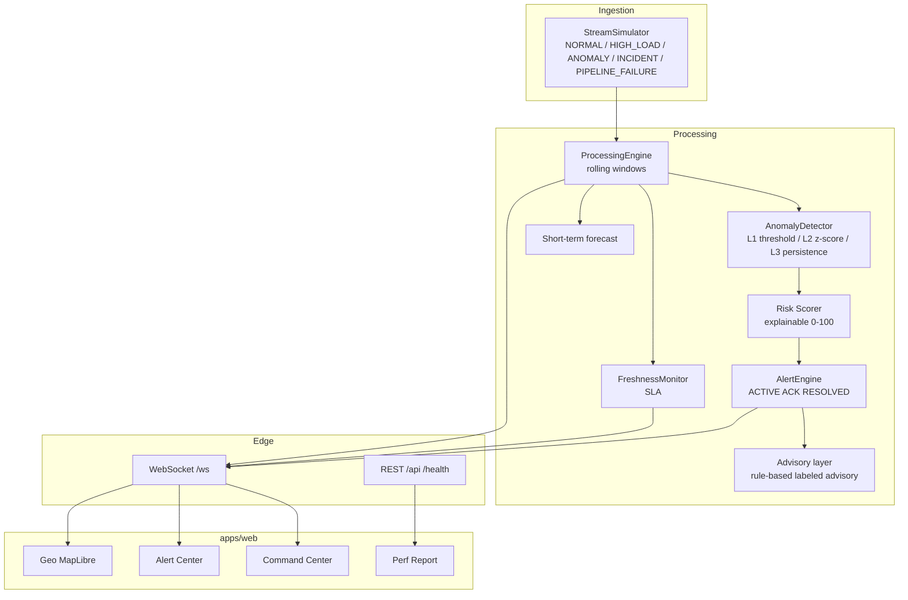

# SENTINEL Architecture

## Overview

SENTINEL is a real-time decision intelligence platform. A configurable simulator produces continuous events; a modular processing pipeline derives KPIs, anomalies, risk, alerts, and freshness; a WebSocket layer fans state out to the Command Center UI.

## Design principles

1. Detection is deterministic/statistical — never delegated to an LLM.
2. AI/advisory content is explicitly labeled and non-actuating.
3. Every UI number comes from the live pipeline.
4. Every alert has a human-readable reason.
5. Simulator is replaceable with real stream sources later.

## Module map (`apps/api`)

| Path | Responsibility |
|------|----------------|
| `stream/simulator.ts` | Continuous event generation with temporal modes |
| `stream/ws.ts` | WebSocket fan-out, heartbeat, snapshot |
| `processing/engine.ts` | Rolling stats, time series, rates |
| `processing/predict.ts` | Linear short-term forecast |
| `anomaly/detector.ts` | Layered anomaly + severity + explanation |
| `anomaly/risk.ts` | Risk contributors |
| `alerts/engine.ts` | Alerts, incidents, acknowledgements |
| `health/freshness.ts` | Freshness + SLA breach events |
| `ai/advisory.ts` | Incident summarization / investigation hints |
| `perf/loadRunner.ts` | Measured load tests |
| `hub.ts` | Orchestration |
| `config.ts` | Env-driven thresholds |

## Freshness SLA

`FreshnessMonitor` tracks last successful event timestamp. If age exceeds `FRESHNESS_SLA_SECONDS`, status moves HEALTHY → DEGRADED → CRITICAL and a system alert is emitted. Recovery clears the breach when events resume.

## Security notes

- No secrets in source; configuration via env
- Zod validation on demo commands and alert filters
- CORS restricted to configured origins
- JSON body size limited
- No `eval` / dynamic code execution
