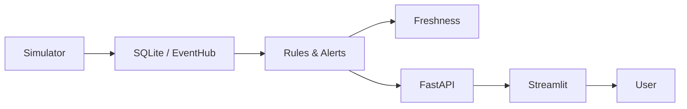

# PulseGuard

Real‑time fraud/risk threshold dashboard demo.

## Overview
- Simulated transaction stream (≈10 events / s) with attack modes.
- FastAPI control + metrics API.
- SQLite WAL store (default) – optional Azure Event Hub sink.
- Streamlit dashboard (auto‑refresh 2 s) with KPI cards, Plotly charts, freshness badge, alerts panel.
- Load‑test script for concurrent viewer stress testing.

## Quick start (one command)
```bash
python run_demo.py
```

The dashboard will be available at `http://localhost:8501`.

## Architecture


## SLA
- Data age < 60 s (p95).
- Transaction rate ≥ 8 events / s.

For full documentation see `docs/fabric_setup.md`.
